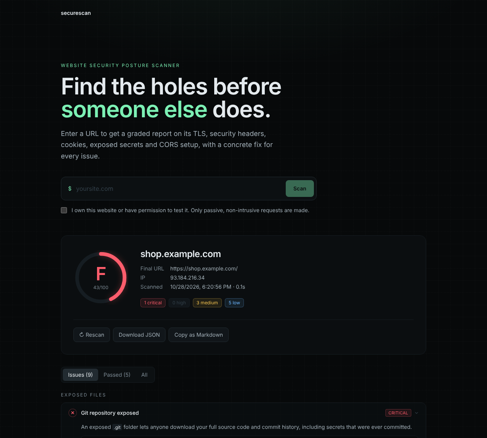

# SecureScan 🛡️

**A website security posture scanner.** Enter a URL and get a graded report (A+ to F) covering TLS, security headers, cookies, exposed secrets, email security (SPF/DMARC/DKIM, MTA-STS, TLS-RPT, BIMI), DNS security, CORS and mixed content, with a plain-English explanation and a concrete fix for every issue.

**🔗 Live demo:** https://securescan-hamze.vercel.app

[](https://github.com/hamze-seere/securescan/actions/workflows/ci.yml)
[](https://github.com/hamze-seere/securescan/actions/workflows/security-scan.yml)



> Built with Next.js 16, React 19, TypeScript and Tailwind CSS v4. The scanner engine has **zero runtime dependencies**: it is written directly on Node's `http`, `https`, `tls` and `dns` modules.

---

## Features

| Area | Checks |
|---|---|
| **Transport** | HTTPS availability · certificate validity (self-signed, expired, wrong host, broken chain) · days to expiry · TLS protocol version and cipher · HTTP→HTTPS redirect |
| **Security headers** | HSTS (max-age, includeSubDomains, preload) · CSP *quality* analysis (`unsafe-inline`, `unsafe-eval`, wildcards, nonces, `strict-dynamic`) · clickjacking (XFO / `frame-ancestors`) · `nosniff` · Referrer-Policy · Permissions-Policy · COOP · deprecated X-XSS-Protection |
| **Cookies** | `Secure`, `HttpOnly`, `SameSite`, judged more strictly for session/auth cookies |
| **Exposed files** | `.env`, `.git/HEAD`, `.git/config`, SQL dumps, `wp-config.php.bak`, `phpinfo.php`, `server-status`, `.DS_Store`, with **content signatures** so "soft-404" sites don't produce false positives · public JavaScript source maps · open redirects through common query parameters (`next`, `url`, `redirect`…) |
| **Email security** | SPF (missing, `+all`, `?all`, duplicate records, >10 DNS lookups) · DMARC policy, `pct`, reporting, subdomain `sp=` inheritance · DKIM keys across 20 common selectors (revoked keys ignored) · MX records · MTA-STS (enforced TLS for incoming mail) · TLS-RPT reporting · BIMI brand logo (only counts with an enforcing DMARC policy) |
| **DNS security** | CAA certificate-authority restrictions (walks up the DNS tree, as the RFC requires) · DNSSEC validation via a validating DNS-over-HTTPS resolver |
| **CORS** | Detects servers that reflect arbitrary origins, especially combined with `Allow-Credentials: true` |
| **Content** | Active/passive mixed content · forms that submit over HTTP |
| **Disclosure** | Versioned `Server` headers · `X-Powered-By` and other stack fingerprints · `security.txt` presence |

Plus:
- **Email breach check:** shows which known data breaches include an email address (breach name, site, date and the kinds of data leaked) and checks the address's domain for SPF, DMARC and DKIM. Uses [XposedOrNot](https://xposedornot.com) for free, or [Have I Been Pwned](https://haveibeenpwned.com) when `HIBP_API_KEY` is set. The address is never stored or logged (see the threat model). Each result also shows:
  - a **breach risk summary**: risk level, password/phone/home-address leak counts, breaches per year and the most-leaked kinds of data, with a warning when a phone number leaked
  - the **address type** (disposable, free webmail or custom domain, role address, plus tag), the **mail provider** from MX records, and the **domain's age** from its registry (RDAP), so brand-new lookalike domains stand out
- **Owner-verified exposure report:** the owner proves the address is theirs with a one-time code sent by email ([Resend](https://resend.com)), then sees their public Gravatar profile (photo, name, linked accounts), which breaches leaked their phone number, home address, name or date of birth, and a prioritised lock-down checklist
- **Shareable report links:** unlisted, 30-day links for reports the server signed, so they can't be forged (see the threat model)
- **README badge:** every shared report has an SVG grade badge at `/api/badge?id=<report id>`
- **Changes since last scan:** rescanning a site lists the issues that are new and the ones you fixed
- **PDF export:** a professional multi-page report generated in the browser, with a score per category
- **GitHub Action and CLI:** gate deployments on a minimum security grade ([setup below](#github-action))
- Scoring and grading with a score per category, a severity breakdown, redirect chain, TLS details, raw headers, JSON export, copy as Markdown, and local scan history

## Quick start

```bash
npm install
cp .env.example .env.local
npm run dev        # http://localhost:3000
npm test           # 125 unit + integration tests
```

To scan a site running on your own machine (e.g. a XAMPP project), set `ALLOW_PRIVATE_TARGETS=true` in `.env.local`. This only works in development; the flag is ignored when `NODE_ENV=production`.

### API

```bash
curl -X POST http://localhost:3000/api/scan \
  -H "Content-Type: application/json" \
  -d '{"url":"example.com","authorized":true}'

curl -X POST http://localhost:3000/api/email \
  -H "Content-Type: application/json" \
  -d '{"email":"you@example.com","authorized":true}'

# Owner verification: email a one-time code, then confirm it to get the exposure report
curl -X POST http://localhost:3000/api/email/verify \
  -H "Content-Type: application/json" \
  -d '{"action":"send","email":"you@example.com"}'

curl -X POST http://localhost:3000/api/email/verify \
  -H "Content-Type: application/json" \
  -d '{"action":"confirm","email":"you@example.com","code":"123456"}'
```

### Deploy

Push to GitHub and import the repo on [Vercel](https://vercel.com). No configuration is needed. Then scan your own deployment: it should get an **A+**.

### Enable share links in production (free)

Locally, share links work out of the box (in-memory store). In production they need Redis:

1. Vercel dashboard → your project → **Storage** → **Create Database** → **Upstash for Redis** (free tier) → connect it to the project.
2. Vercel adds `KV_REST_API_URL` and `KV_REST_API_TOKEN` automatically. **Redeploy**.

Until then, the **Share link** button is simply hidden. Everything else works.

With Redis connected, rate limits are also shared across all serverless instances.

### Configuration

| Variable | Default | Purpose |
|---|---|---|
| `SCAN_RATE_LIMIT` | `5` | Scans per client IP per minute |
| `SCAN_TARGET_RATE_LIMIT` | `10` | Scans of one hostname per 10 minutes, from all clients together |
| `HIBP_API_KEY` | | [Have I Been Pwned](https://haveibeenpwned.com/API/Key) key (paid). When set, email checks use HIBP instead of the free XposedOrNot API |
| `EMAIL_RATE_LIMIT` | `3` | Email checks per client IP per hour |
| `EMAIL_TARGET_RATE_LIMIT` | `3` | Checks of one email address per hour, from all clients together |
| `EMAIL_DAILY_LIMIT` | `90` (`2000` with HIBP) | Email checks per day for the whole site, kept under the provider's quota |
| `RESEND_API_KEY` | | [Resend](https://resend.com) key. Turns on the owner-verified exposure report (production also needs Redis to hold the codes) |
| `EMAIL_FROM` | `SecureScan <onboarding@resend.dev>` | Sender for verification codes. The default only delivers to your own Resend account address; verify a domain to send to anyone |
| `EMAIL_VERIFY_RATE_LIMIT` | `3` | Codes sent per client IP per hour |
| `EMAIL_VERIFY_TARGET_RATE_LIMIT` | `3` | Codes sent to one address per hour |
| `EMAIL_VERIFY_DAILY_LIMIT` | `50` | Codes sent per day for the whole site |
| `EMAIL_VERIFY_DEV_BYPASS` | `false` | Development only: skip the email and show the code on the page. Ignored when `NODE_ENV=production` |
| `SHARE_SECRET` | derived from `KV_REST_API_TOKEN` | Key that signs reports for sharing (and keys the email rate limit). Set it to rotate the key without changing Redis |
| `KV_REST_API_URL` / `KV_REST_API_TOKEN` | | Upstash Redis, for share links and shared rate limits |

---

## GitHub Action

Use SecureScan as a security gate in any repository. The step fails if the grade drops below `min-grade`, writes a results table to the workflow summary, and (if sharing is enabled) links the full report.

```yaml
# .github/workflows/security.yml
on:
  deployment_status:            # after each deployment (Vercel, Netlify… report these to GitHub)
  schedule:
    - cron: "0 6 * * 1"         # and every Monday
  workflow_dispatch:

jobs:
  security-scan:
    if: github.event_name != 'deployment_status' || github.event.deployment_status.state == 'success'
    runs-on: ubuntu-latest
    steps:
      - uses: hamze-seere/securescan@main
        id: scan
        with:
          url: https://your-site.com                       # a site you own
          api-url: https://securescan-hamze.vercel.app     # any SecureScan deployment
          min-grade: B                                     # A+, A, B, C, D or F
      - run: echo "Grade ${{ steps.scan.outputs.grade }} - ${{ steps.scan.outputs.report-url }}"
```

| Input | Required | Default | Description |
|---|---|---|---|
| `url` | ✅ | | Site to scan |
| `api-url` | ✅ | | Base URL of a SecureScan deployment |
| `min-grade` | | `B` | Fail below this grade |
| `share` | | `true` | Create a 30-day report link |

Outputs: `grade`, `score`, `report-url`.

`@main` follows the latest code. For production pipelines, pin a full commit SHA (`hamze-seere/securescan@<sha>`) so an update can't change your build without you noticing.

**Scheduled scans.** Add a `schedule` trigger to rescan weekly, which catches certificates about to expire and headers that a deploy dropped. [`security-scan.yml`](.github/workflows/security-scan.yml) is a complete example:

```yaml
on:
  schedule:
    - cron: "17 6 * * 1"   # Mondays 06:17 UTC
  workflow_dispatch:
```

### CLI

The same check from a terminal, with no dependencies beyond Node 20+:

```bash
npx github:hamze-seere/securescan https://your-site.com --min-grade B
```

Options: `--api <url>` (or `SECURESCAN_API`) to use your own deployment, `--sarif <file>`, `--no-share`. Exit code `1` means the grade is below the minimum, `2` means bad arguments.

This repository uses its own action: [`security-scan.yml`](.github/workflows/security-scan.yml) scans the live site after every production deployment and weekly, and [`ci.yml`](.github/workflows/ci.yml) runs lint, tests, the production build and `npm audit` on every push.

---

## Security design & threat model

A tool that fetches arbitrary user-supplied URLs from a server is itself an attack surface. This section documents the threats and how each one is mitigated.

### 1. Server-Side Request Forgery (SSRF), the main threat
An attacker submits `http://169.254.169.254/latest/meta-data/` (cloud credentials), `http://localhost:6379` (Redis) or an internal admin panel, and uses the scanner as a proxy into the private network.

**Mitigations** (`src/lib/scanner/ssrf.ts`, `httpClient.ts`):
- **Allow-list of schemes and ports:** only `http`/`https` on 80, 443, 8080 and 8443. No `file://`, `gopher://` or credentials in URLs.
- **IP range block-list for IPv4 and IPv6:** loopback, RFC 1918, link-local/metadata, CGNAT, multicast, reserved, unique-local, IPv4-mapped IPv6 (`::ffff:127.0.0.1`), NAT64 and 6to4.
- **Encoding tricks** (`http://2130706433`, `0x7f000001`, `0177.0.0.1`) are normalised by the WHATWG URL parser before the check (covered by tests).
- **DNS rebinding defence:** validation happens inside a custom `lookup` hook *at socket-connect time*, so the IP we validate is the IP we connect to. A hostname that resolves to a public IP during a pre-check and a private IP afterwards cannot get through.
- **Every redirect hop is re-validated**, so a public site can't `302` us into `http://localhost`.

### 2. Denial of service and resource exhaustion
- Per-IP **rate limiting** (5 scans/min by default) on `/api/scan`, returning `429` with `Retry-After`. With Redis it holds across serverless instances.
- A **per-target limit** (10 scans per hostname per 10 minutes), so many IPs together can't point the scanner at one site.
- An overall **20-second budget** per scan. Checks that don't finish in time are left out and the report is marked partial instead of failing.
- **Timeouts** on every request (8s for the page, 6s for probes) and a cap of 5 redirects.
- **Response size caps** applied *after* decompression (512 KB for the page, 64 KB for probes), which protects against gzip/brotli zip bombs.

### 3. Abuse as an attack tool
- Checks are **passive and non-intrusive**: a handful of `GET` requests for well-known paths. No fuzzing, injection payloads or brute force.
- Users must confirm they **own or are authorised** to test the target, and the API enforces this.
- The scanner identifies itself honestly in its `User-Agent`.

### 4. Cross-site scripting through scan results
Scan results contain attacker-controlled data (headers, cookie names, URLs). Everything is rendered through React, which escapes output. There is no `dangerouslySetInnerHTML` anywhere. As a second layer, the app ships a **nonce-based CSP with `strict-dynamic`** (`src/proxy.ts`).

### 5. Forged reports via share links
If the share endpoint accepted a report from the browser, anyone could publish a fake "Grade F, `.env` exposed!" report about a site they dislike, on a legitimate-looking link under our domain.

**Mitigation** (`src/lib/reports.ts`): the server signs every report it produces with an HMAC-SHA256 over the whole report, and `/api/share` only publishes a report whose signature matches (compared in constant time). Changing a single field breaks the signature. Signed reports can be shared for 1 hour after the scan, and nothing is written to the store until someone shares. IDs are random UUIDv4s (122 bits, unguessable) validated with a strict regex (no key injection), the signature is removed before storing, shared pages are `noindex`, and links expire after 30 days. Covered by tests.

### 6. Information leakage
- Unexpected errors are logged server-side; clients only get a generic message, never stack traces.
- `poweredByHeader: false` and a full set of security headers (`next.config.ts`).
- Scan history is stored only in the user's own browser (`localStorage`), not on the server.

### 7. Email lookups: privacy and stalking
The email check looks up an address that may belong to someone else, so it is built to reveal as little as possible (`src/lib/emailCheck.ts`, `src/lib/breach.ts`):
- The address is **never stored or logged**. Errors log only the error type, and a test checks that the address never reaches the logs. The per-address rate limit is keyed by an HMAC of the address, not the address itself.
- Responses echo only a **masked address** (`ha***@example.com`) and are sent with `Cache-Control: no-store`. Email results are not saved in scan history or share links.
- Only **breach summaries** are returned: name, site, date and kinds of data. Never passwords, records or anything else from a leak.
- The provider is called **from the server only**, so the browser's CSP still allows no third-party connections.
- Users must confirm the address is **theirs or that they have permission**, and the API enforces it.
- **Rate limits** per IP (3/hour), per address across all IPs (3/hour) and for the whole site per day, so the tool can't be used for bulk lookups or burn the provider's quota.

- Address type, mail provider and domain age come from the address itself, public DNS and the domain's registry (RDAP), looked up **server-side** and cached. They say nothing about the person.

The **owner-verified exposure report** (`src/lib/exposure.ts`) shows more personal detail, so it is only given to someone who can read the inbox:
- A 6-digit code is emailed to the address. Only HMACs of the address and the code are stored, for 10 minutes; the code works once and is compared in constant time.
- **5 wrong tries** lock that address for 10 minutes, and sends are limited per IP, per address and per day, so the endpoint can't be used to spam inboxes. Disposable inboxes are refused.
- The report includes the public **Gravatar** profile, the only source that maps an email to a profile with the owner's consent (they published it). The photo is fetched by the server and inlined as a `data:` URL, so the browser still makes no third-party requests and the CSP is unchanged. Only PNG/JPEG/GIF/WebP up to 256 KB, and only `https:` links, are passed on.
- It does **not** probe sign-up or password-reset forms to find accounts on other sites. That breaks those sites' terms and is how account-enumeration tools work.
- `EMAIL_VERIFY_DEV_BYPASS` shows the code on the page for local testing and is ignored in production.

Breach data comes from [XposedOrNot](https://xposedornot.com) or, with a key, [Have I Been Pwned](https://haveibeenpwned.com) (licensed under CC BY 4.0). Each result credits its source.

### Known limitations
- Without Redis, rate limits are kept in memory per instance, so on serverless platforms they are only approximate.
- The open-redirect probe only tries common parameter names on the home page. Redirects elsewhere can't be found without crawling.
- TLS checks report the negotiated protocol only. They don't enumerate every supported cipher suite (use `testssl.sh` for that).
- Content checks analyse the initial HTML, not JavaScript-rendered DOM.
- DKIM can only be confirmed for common selector names; custom selectors can't be discovered from DNS.
- Organisational-domain detection (for DMARC/CAA fallback) covers common two-level suffixes (`co.uk`, `edu.so`…) but isn't the full Public Suffix List.
- PDF exports are generated client-side. For an authoritative record, share the server-stored link.

## Project structure

```
src/
├── app/
│   ├── api/scan/route.ts     # POST endpoint: validation, rate limit, error mapping
│   ├── api/share/route.ts    # turns a server-signed scan into a 30-day link
│   ├── api/badge/route.ts    # SVG grade badge for shared reports
│   ├── api/email/route.ts    # email breach check endpoint
│   ├── api/email/verify/route.ts # one-time code + owner exposure report
│   ├── r/[id]/page.tsx       # shared report page (noindex)
│   ├── layout.tsx / page.tsx
│   └── globals.css           # Tailwind v4 theme tokens
├── components/               # Scanner (form + history), Report, GradeBadge, SiteChrome
├── lib/
│   ├── rateLimit.ts          # Redis fixed window, in-memory fallback
│   ├── store.ts              # Upstash Redis REST client / dev memory store
│   ├── reports.ts            # HMAC-signed share flow
│   ├── breach.ts             # breach providers (XposedOrNot, Have I Been Pwned)
│   ├── emailCheck.ts         # email check: limits, privacy rules, domain checks
│   ├── emailInsights.ts      # address type, mail provider, domain age (RDAP), risk summary
│   ├── exposure.ts           # owner verification (Resend), Gravatar, lock-down steps
│   ├── reportView.ts         # labels, Markdown export, scan-to-scan diff
│   ├── badge.ts              # README badge SVG
│   ├── pdf.ts                # PDF report builder (pdf-lib)
│   └── scanner/
│       ├── ssrf.ts           # URL + IP validation
│       ├── httpClient.ts     # hardened HTTP client (safe lookup, size caps, TLS info)
│       ├── dnsClient.ts      # DNS + DNSSEC (DoH) lookups, injectable for tests
│       ├── checks/           # one module per category
│       ├── score.ts          # scoring and grading
│       └── index.ts          # runScan() orchestrator
└── proxy.ts                  # per-request nonce CSP
action.yml + action/          # the GitHub Action
.github/workflows/            # CI and scheduled self-scan
tests/                        # node:test suites incl. an end-to-end scan of an insecure server
```

## Scoring

Each finding has a severity weight (critical 30, high 15, medium 8, low 3). A failed check costs its full weight and a warning costs half. Any **critical** failure (invalid certificate, no HTTPS, exposed `.env`/`.git`/database dump) caps the grade at **F**. An **A+** requires a score of 95 or more, valid HSTS and a strong CSP, and no high or medium failures.

## Ethics

Only scan systems you own or have explicit permission to test. Unauthorised testing may be illegal in your jurisdiction.

## License

MIT
