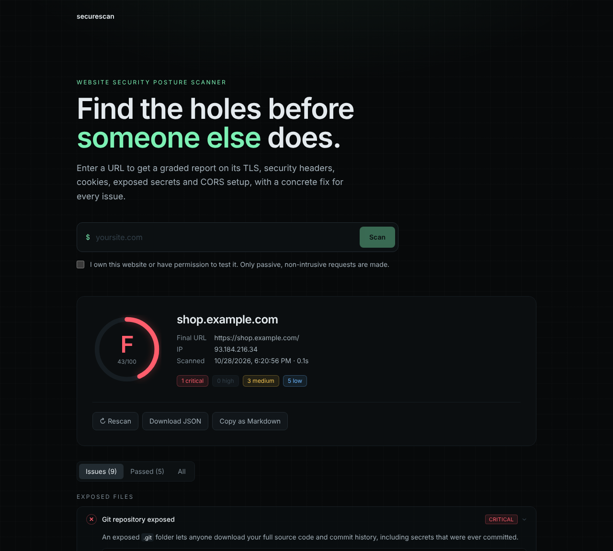

# SecureScan 🛡️

**A website security posture scanner.** Enter a URL and get a graded report (A+ to F) covering TLS, security headers, cookies, exposed secrets, CORS and mixed content, with a plain-English explanation and a concrete fix for every issue.



> Built with Next.js 16, React 19, TypeScript and Tailwind CSS v4. The scanner engine has **zero runtime dependencies**: it is written directly on Node's `http`, `https`, `tls` and `dns` modules.

---

## Features

| Area | Checks |
|---|---|
| **Transport** | HTTPS availability · certificate validity (self-signed, expired, wrong host, broken chain) · days to expiry · TLS protocol version and cipher · HTTP→HTTPS redirect |
| **Security headers** | HSTS (max-age, includeSubDomains, preload) · CSP *quality* analysis (`unsafe-inline`, `unsafe-eval`, wildcards, nonces, `strict-dynamic`) · clickjacking (XFO / `frame-ancestors`) · `nosniff` · Referrer-Policy · Permissions-Policy · COOP · deprecated X-XSS-Protection |
| **Cookies** | `Secure`, `HttpOnly`, `SameSite`, judged more strictly for session/auth cookies |
| **Exposed files** | `.env`, `.git/HEAD`, `.git/config`, SQL dumps, `wp-config.php.bak`, `phpinfo.php`, `server-status`, `.DS_Store`, with **content signatures** so "soft-404" sites don't produce false positives |
| **CORS** | Detects servers that reflect arbitrary origins, especially combined with `Allow-Credentials: true` |
| **Content** | Active/passive mixed content · forms that submit over HTTP |
| **Disclosure** | Versioned `Server` headers · `X-Powered-By` and other stack fingerprints · `security.txt` presence |

Plus: scoring and grading, a severity breakdown, redirect chain, TLS certificate details, raw headers, **JSON export**, **copy as Markdown** (paste into a GitHub issue or bug report), and local scan history.

## Quick start

```bash
npm install
cp .env.example .env.local
npm run dev        # http://localhost:3000
npm test           # 19 unit + integration tests
```

To scan a site running on your own machine (e.g. a XAMPP project), set `ALLOW_PRIVATE_TARGETS=true` in `.env.local`. This only works in development; the flag is ignored when `NODE_ENV=production`.

### API

```bash
curl -X POST http://localhost:3000/api/scan \
  -H "Content-Type: application/json" \
  -d '{"url":"example.com","authorized":true}'
```

### Deploy

Push to GitHub and import the repo on [Vercel](https://vercel.com). No configuration is needed. Then scan your own deployment: it should get an **A+**.

---

## Security design & threat model

A tool that fetches arbitrary user-supplied URLs from a server is itself an attack surface. This section documents the threats and how each one is mitigated.

### 1. Server-Side Request Forgery (SSRF), the main threat
An attacker submits `http://169.254.169.254/latest/meta-data/` (cloud credentials), `http://localhost:6379` (Redis) or an internal admin panel, and uses the scanner as a proxy into the private network.

**Mitigations** (`src/lib/scanner/ssrf.ts`, `httpClient.ts`):
- **Allow-list of schemes and ports:** only `http`/`https` on 80, 443, 8080 and 8443. No `file://`, `gopher://` or credentials in URLs.
- **IP range block-list for IPv4 and IPv6:** loopback, RFC 1918, link-local/metadata, CGNAT, multicast, reserved, unique-local, IPv4-mapped IPv6 (`::ffff:127.0.0.1`), NAT64 and 6to4.
- **Encoding tricks** (`http://2130706433`, `0x7f000001`, `0177.0.0.1`) are normalised by the WHATWG URL parser before the check (covered by tests).
- **DNS rebinding defence:** validation happens inside a custom `lookup` hook *at socket-connect time*, so the IP we validate is the IP we connect to. A hostname that resolves to a public IP during a pre-check and a private IP afterwards cannot get through.
- **Every redirect hop is re-validated**, so a public site can't `302` us into `http://localhost`.

### 2. Denial of service and resource exhaustion
- Per-IP **rate limiting** (5 scans/min by default) on `/api/scan`, returning `429` with `Retry-After`.
- **Timeouts** on every request (8s for the page, 6s for probes) and a cap of 5 redirects.
- **Response size caps** applied *after* decompression (512 KB for the page, 64 KB for probes), which protects against gzip/brotli zip bombs.

### 3. Abuse as an attack tool
- Checks are **passive and non-intrusive**: a handful of `GET` requests for well-known paths. No fuzzing, injection payloads or brute force.
- Users must confirm they **own or are authorised** to test the target, and the API enforces this.
- The scanner identifies itself honestly in its `User-Agent`.

### 4. Cross-site scripting through scan results
Scan results contain attacker-controlled data (headers, cookie names, URLs). Everything is rendered through React, which escapes output. There is no `dangerouslySetInnerHTML` anywhere. As a second layer, the app ships a **nonce-based CSP with `strict-dynamic`** (`src/proxy.ts`).

### 5. Information leakage
- Unexpected errors are logged server-side; clients only get a generic message, never stack traces.
- `poweredByHeader: false` and a full set of security headers (`next.config.ts`).
- Scan history is stored only in the user's own browser (`localStorage`), not on the server.

### Known limitations
- The in-memory rate limiter is per-instance. On serverless platforms, use a shared store such as Upstash Redis.
- TLS checks report the negotiated protocol only. They don't enumerate every supported cipher suite (use `testssl.sh` for that).
- Content checks analyse the initial HTML, not JavaScript-rendered DOM.

## Project structure

```
src/
├── app/
│   ├── api/scan/route.ts     # POST endpoint: validation, rate limit, error mapping
│   ├── layout.tsx / page.tsx
│   └── globals.css           # Tailwind v4 theme tokens
├── components/               # Scanner (form + history), Report, GradeBadge
├── lib/
│   ├── rateLimit.ts
│   └── scanner/
│       ├── ssrf.ts           # URL + IP validation
│       ├── httpClient.ts     # hardened HTTP client (safe lookup, size caps, TLS info)
│       ├── checks/           # one module per category
│       ├── score.ts          # scoring and grading
│       └── index.ts          # runScan() orchestrator
└── proxy.ts                  # per-request nonce CSP
tests/                        # node:test suites incl. an end-to-end scan of an insecure server
```

## Scoring

Each finding has a severity weight (critical 30, high 15, medium 8, low 3). A failed check costs its full weight and a warning costs half. Any **critical** failure (invalid certificate, no HTTPS, exposed `.env`/`.git`/database dump) caps the grade at **F**. An **A+** requires a score of 95 or more, valid HSTS and a strong CSP, and no high or medium failures.

## Ethics

Only scan systems you own or have explicit permission to test. Unauthorised testing may be illegal in your jurisdiction.

## License

MIT
